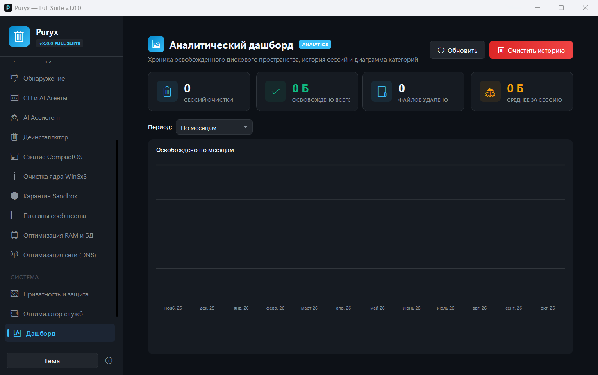
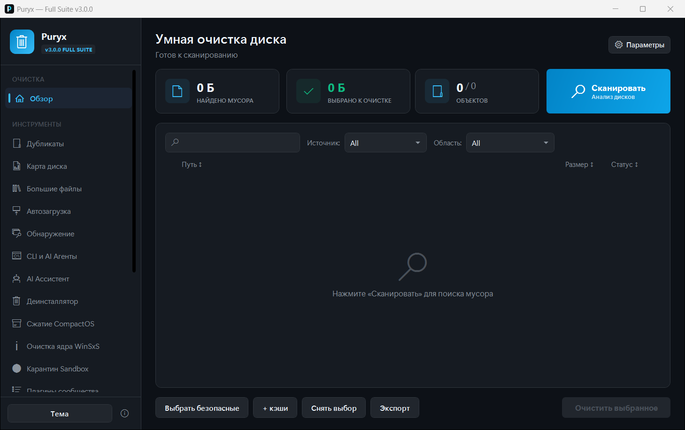
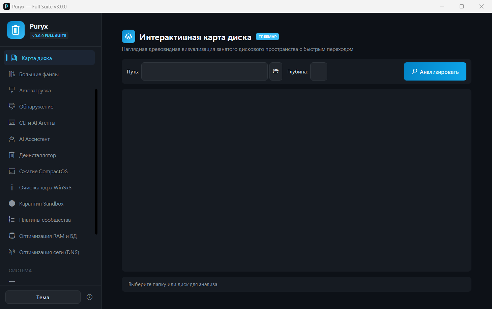
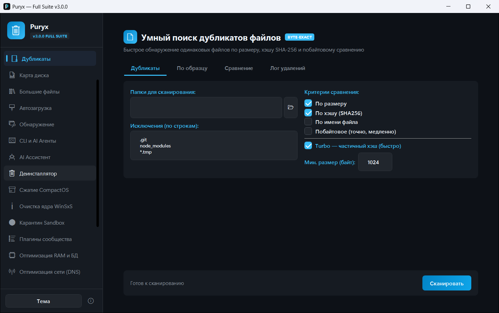

<p align="center">
  <a href="https://github.com/Harbuzilia/Puryx">
    
  </a>
</p>

<h1 align="center">Puryx</h1>

<p align="center"><strong>English</strong> | <a href="README.ru.md">Русский</a></p>

<p align="center"><strong>Puryx — smart cleanup and optimization for Windows: 16 scanners, safe deletion, NTFS Compact, privacy. .NET 8 / WPF</strong></p>

<p align="center">
  <a href="https://github.com/Harbuzilia/Puryx"></a>
  <a href="https://github.com/Harbuzilia/Puryx/actions/workflows/ci.yml"></a>
  <a href="https://github.com/Harbuzilia/Puryx"></a>
  <a href="https://github.com/Harbuzilia/Puryx"></a>
  <a href="https://github.com/Harbuzilia/Puryx"></a>
</p>

<p align="center">
  <a href="https://github.com/Harbuzilia/Puryx">Repository</a> ·
  <a href="CHANGELOG.md">Changelog</a> ·
  <a href="LICENSE">MIT License</a>
</p>

---

## 🚀 Quick Start

**Option A — portable (single exe, no installation):**

1. **Download** the portable build from the [Releases](https://github.com/Harbuzilia/Puryx/releases) page.
2. **Run** the downloaded `Puryx-3.1.0-portable-win-x64.exe`. The app is not code-signed: on first launch Windows SmartScreen will show a warning — click "More info" → "Run anyway".

**Option B — Scoop (package manager):**

```powershell
scoop bucket add puryx https://github.com/Harbuzilia/scoop-bucket
scoop install puryx
```

**Scan**: start a scan (`Ctrl + S`), review the results and clean the selected items (`Delete`) — deleted files go to the Recycle Bin by default and can be restored.

> What's new — [CHANGELOG.md](CHANGELOG.md): release 3.1.0; the version history follows below.

---

## 💡 Why Puryx

- **Multi-layered deletion safety.** A glob-pattern whitelist (AI agents, game saves, git repositories, databases), a 24-hour protection period for user data, and file-lock checks.
- **Recycle Bin by default.** All deleted files go to the Recycle Bin with instant restore; quarantine is an isolated store with a safe return to the original directories.
- **Signed elevated protocol.** The elevated-cleaning request is signed with HMAC-SHA256 based on a one-time auth token, is time-limited (TTL) and replay-protected via a nonce; only requests from the temp folder with allowed roots are accepted.
- **16 scanners in a single app** — from system caches and browsers to node_modules, pip, WSL2, Docker and GPU shader caches.
- **19 specialized sections and tools** — from NTFS Compact and Game Boost to duplicate search, DiskMap and the uninstaller.
- **JSON-manifest plugins.** New cleanup rules are added as `*.plugin.json` files without code changes — built-in and user manifests.
- **Portable mode.** A `portable.txt` marker next to the executable moves the configuration into the portable build — no traces in `%APPDATA%`.
- **Fluent UI with themes.** Windows 11 Fluent Design, dark/light/system theme switching with saved preferences.
- **Interface: English & Русский.** The app language is switched in Settings (Auto / Русский / English) and applies on the next launch.
- **629 unit tests** (xUnit) cover the cleaning engine, safety, plugins, duplicates and the CLI inspector.

---

## 📸 Screenshots

<!-- MAINTAINER NOTE: the current screenshots live in docs/screenshots/
     (dark theme, state before the first scan — no data yet).
     To update: launch the app, open the section (Dashboard / Overview / Disk Map / Duplicates),
     capture the whole window and save the PNG under the same name as in the tags below:
     dashboard.png, cleanup.png, diskmap.png, duplicates.png. -->






---

## 🔍 16 Built-in Scanners

| Scanner | Description |
|---------|-------------|
| **System** | Temp, Prefetch, WER (error reports), CrashDumps, Thumbnail Cache, Windows Update cache |
| **Browsers** | Chrome, Edge, Brave, Opera, Vivaldi, Yandex, Firefox — cache, logs and temporary data |
| **Applications** | Telegram, Discord, Spotify, Steam, Obsidian, Postman, Figma, JetBrains, VS Code, Slack cache |
| **Games** | Steam, Epic Games, NVIDIA / AMD / Intel shader caches, Unity, Unreal Engine |
| **Development** | WSL2 virtual disks (ext4.vhdx), Rust cargo/target, Gradle, Maven, Go, Android SDK, Unity/Unreal DDC |
| **AI Agents** | Cursor, VSCode AI, Windsurf, Claude — cache (Antigravity, Kiro and critical data are protected) |
| **Package Caches** | npm, yarn, pnpm, pip, NuGet, vcpkg, cargo caches |
| **Node Modules** | Recursive node_modules search with age and lock-file analysis |
| **NPM Packages** | Inventory of installed npm packages |
| **Python Packages** | Inventory of pip packages in venv and system |
| **.NET Build** | `bin/` and `obj/` folders in projects that can be rebuilt |
| **Python Venv** | `.venv`/`venv` virtual environments with staleness analysis |
| **Docker** | Detection of dangling images, stopped containers and builder cache |
| **Disk Analysis** | Large folders and files (>100MB) |
| **Custom Folder** | Scanning any arbitrary directory on request |

---

## 🧰 19 Specialized Sections and Tools

1. **Dashboard & Statistics**:
   - KPI metrics for freed space, cleanup sessions and removed files.
   - Historical weekly charts of freed space.

2. **Disk Cleanup**:
   - Scan profiles (*Quick*, *Development*, *Full*).
   - Full-text search (`Ctrl+F`), safe selection (`Ctrl+A`), sorting by size, path and risk.
   - Export results to CSV and JSON.

3. **System Deep Clean**:
   - Analysis and compression of the WinSxS component store (`Dism.exe /ResetBase`).
   - Cleanup of old device driver versions (Driver Store).

4. **Disk Compression (Compact NTFS)**:
   - Transparent compression of system files and applications with Windows CompactOS algorithms (XPRESS4K, XPRESS8K, XPRESS16K, LZX) without performance loss.

5. **RAM Optimization (Ram Optimizer & Game Boost)**:
   - Working-set trim of processes (EmptyWorkingSet), Standby List and Modified Page List cleanup.
   - Game Boost turbo mode: background resource-hungry services are forcibly suspended for the duration of game sessions.

6. **Network & DNS Optimizer**:
   - 1-Click reset of the DNS cache (`ipconfig /flushdns`), Winsock and the TCP/IP network stack.
   - Latency (Ping) testing of public DNS servers (Cloudflare, Google, Quad9) with quick switching.

7. **Privacy Protection (Anti-Spy Telemetry Debloater)**:
   - Disabling telemetry, DiagTrack diagnostic data, WAP Push, ads in Explorer and the Start menu, WER and geolocation.
   - Registry backup before applying tweaks and 1-click rollback.

8. **Windows Services Optimizer**:
   - Ready-made presets (Gaming / Max FPS, Balanced, Office) for safely disabling unused background services.
   - Snapshot of the original service state and rollback to defaults.

9. **Duplicate Finder**:
   - 4 modes: duplicate search (SHA-256 / Turbo hash / byte-by-byte comparison), search by pattern, folder comparison, deletion log.
   - Built-in image and text preview.

10. **Disk Map**:
    - Interactive visualization of disk space as a Squarified TreeMap with color differentiation by depth and zoom support.

11. **Large Files**:
    - Fast search and sorting of the heaviest files on disk with filtering by minimum size and count.

12. **Startup**:
    - Analysis of startup entries (Registry Run/RunOnce, startup folders, Task Scheduler), enable/disable and removal.

13. **Program Uninstaller**:
    - Batch removal of Win32 and UWP applications with leftover search in the registry and on disk.

14. **CLI Inspector**:
    - Inventory and cleanup of package-manager caches (npm, pip, cargo, nuget, vcpkg) and command-line tools.

15. **AI Assistant**:
    - An intelligent assistant for disk-space analysis and safe-cleanup recommendations.

16. **Quarantine**:
    - An isolated store of deleted files with safe restore to the original directories.

17. **Scheduler**:
    - Scheduled automatic cleanup via Windows Task Scheduler (daily / weekly) in a quiet background mode.

18. **Plugins**:
    - Modular architecture with support for external scanners and user cleanup rules.

19. **App Discovery**:
    - Heuristic search for unknown programs with an accumulated cache and addition to the knowledge base.

---

## 🛡️ Security

- **Multi-layered protection:** a glob-pattern whitelist (AI agents, game saves, git repositories, databases), a 24-hour protection period for user files, and file-lock checks.
- **Recycle Bin deletion:** by default all files go to the Recycle Bin with instant restore.
- **Quarantine:** deleted objects are isolated in a separate store with safe restore to the original path.
- **Elevated Cleaning:** a separate UAC-elevated process is launched only for system directories — upon a signed request with an auth token, TTL and replay protection.

Found a vulnerability? Please report it via [SECURITY.md](SECURITY.md).

---

## 🔒 Privacy & Trust

- **Open source (MIT).** The whole product is in this repository — scanners, safety checks and the updater. Read the code before you run it: [LICENSE](LICENSE).
- **No telemetry.** Puryx sends no usage data, no crash reports and no machine identifiers, and ships no analytics or advertising SDKs.
- **The only network call is an update check — and it is optional.** It queries GitHub Releases; automatic checking is **off by default** and, when enabled, runs at most once a day. It only notifies: downloading and installing happen after an explicit confirmation, and the package is verified against the SHA256 published in the release notes — an asset without a hash is refused. No accounts, no cloud, no sync.
- **No ads, bundles or upsells.** No third-party installers shipped alongside, no "PRO" nag screens, no sponsored offers. The portable build keeps its configuration next to the executable.
- **Safety-first by design.** Deletion goes to the Recycle Bin by default, quarantine offers a return path, the glob whitelist is a hard veto, and every item carries an honest risk category — see [Security](#-security). A cleaner that leaves the system worse than before is not a feature.
- **Registry "cleaning" is deliberately absent.** Microsoft's support policy for registry cleaning utilities (KB2563254) does not support such tools: the registry is not designed to be cleaned routinely. Puryx never scans for or deletes registry leftovers. Its optional system tweaks are separate, explicit switches with a documented restore path — not a bulk "optimize" that silently rewrites your system.

Why say this out loud? Because the market norm is the opposite: "one-click optimizers" that ship registry cleaners, bundled installers and subscription walls. We do not — and the code in this repository is the proof.

---

## 🎨 Design & Interface

- Windows 11 Fluent Design with smooth animations, rounded corners and a card-based style.
- **Dynamic theme switching:** Dark, Light or Auto (System) with saved preferences.
- **Keyboard shortcuts:**
  - `Ctrl + A` — Select all safe items
  - `Ctrl + F` — Search in results
  - `Ctrl + S` — Start a scan
  - `Delete` — Clean the selected items
  - `Escape` — Cancel the scan
- Windows Explorer context-menu integration (the "Scan with SmartCleaner" item — the menu item name is still historical).
- Drag & Drop of folders right into the main window.

---

## 🛠️ Tech Stack

- **C# 12 / .NET 8.0 LTS** — Windows Presentation Foundation (WPF)
- **MVVM** — `CommunityToolkit.Mvvm`
- **DI** — `Microsoft.Extensions.DependencyInjection`
- **Glob matching** — `DotNet.Glob`
- **Tests** — xUnit (`SmartCleaner.Core.Tests`)

---

## 📦 Build & Run

```bash
# Build the project
dotnet build SmartCleaner.sln

# Run the tests
dotnet test SmartCleaner.sln

# Interactive build & publish menu
build.bat

# Single-file portable build (release\portable\SmartCleaner.App.exe)
publish_portable.bat
```

Run without arguments, `build.bat` opens a menu: Debug/Release build, tests, portable publish, run, clean, restore.

> **SmartScreen.** The app is not code-signed: on first launch Windows SmartScreen will show a warning — click "More info" → "Run anyway". The signing decision is recorded: v3.0 ships unsigned ([docs/CODE-SIGNING.md](docs/CODE-SIGNING.md)).

---

## 🧑‍💻 Development

Build and test rules, commit style and branching model — [CONTRIBUTING.md](CONTRIBUTING.md). Distribution via winget and Scoop — [docs/RESEARCH-WINGET.md](docs/RESEARCH-WINGET.md).

### Solution Structure

| Project | Purpose |
|---------|---------|
| `SmartCleaner.App` | WPF application: Views, ViewModels, DI registration in `App.xaml.cs` |
| `SmartCleaner.Core` | Domain logic: scanners, cleaning, safety, plugins, optimization |
| `SmartCleaner.Core.Tests` | xUnit tests for the cleaning engine, safety and plugins |
| `SmartCleaner.Data` | Built-in `Plugins/*.plugin.json` plugins (copied to the build output) |

The solution is `SmartCleaner.sln`, the DI entry point is `SmartCleaner.App/App.xaml.cs`.

### How to Add a Scanner

1. Implement `IScannerStrategy` in `SmartCleaner.Core/Scanning/Scanners/` (`CategoryName`, `CategoryIcon`, `DisplayOrder`, `IsEnabledByDefault`, `ScanAsync`).
2. Register the scanner in DI: `services.AddSingleton<IScannerStrategy, MyScanner>();` in `App.xaml.cs`.

### How to Add a Cleanup Rule via a Plugin

A `*.plugin.json` manifest contains `Id`, `Name`, `Version`, `Category`, `Rules` (path templates `PathTemplate`, `Pattern`, `Recursive`, `Excludes`). Copy it to `Plugins/` next to the app or to `%APPDATA%\SmartCleaner\Plugins`. Any path coming from a plugin goes through the same safety check and is deleted only to the Recycle Bin.

### Code Names

The codebase is historically named `SmartCleaner.*`: the namespaces, the `SmartCleaner.App.exe` assembly, the `SmartCleaner.sln` solution and the build commands are not renamed. The user-facing project name is **Puryx**.

---

## 📄 License

MIT — see [LICENSE](LICENSE). Change history: [CHANGELOG.md](CHANGELOG.md).
